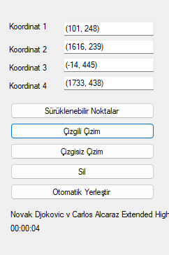

# Tenis Veri Toplama ve Video Analiz Sistemi
### Tennis Data Collection & Video Analytics Tool

<p align="center">
  
</p>

Tenis müsabakaları ve antrenman kayıtları üzerinden yüksek doğrulukla **veri toplama**, **kort bölgelendirme** ve **vuruş analizi** gerçekleştirmek üzere geliştirilmiş profesyonel masaüstü yazılımıdır. 

Uygulama; C# (.NET Framework / WinForms) kullanıcı arayüzü ile Python (OpenCV, PyQt5, Homografi & Geometri Hesaplama) analiz motorunu entegre ederek çalışır.

---

## 📸 Ekran Görüntüleri

### Kort Kalibrasyonu ve Analiz Paneli
Aşağıdaki ekran görüntüsünde tespit edilen kort koordinatları ve interaktif çizim kontrol paneli gösterilmektedir:

<p align="center">
  
</p>

---

## 🎯 Temel Yetenekler

### 1. Tenis Veri Girişi Modülü
* **Sporcu Yönetimi:** Oyuncu profilleri, ad, soyad ve antrenör notlarının kaydı.
* **Vuruş ve Spin Kategorizasyonu:** Forehand, backhand, vole gibi vuruş stilleri ile topspin, slice ve flat gibi spin türlerinin dinamik yönetimi.
* **Veritabanı Entegrasyonu:** Tüm toplanan etiketleme verilerinin yapılandırılmış yerel SQLite veritabanında saklanması ve yedeklenmesi.

### 2. Tenis Video Analizi ve Kort Eşleme Modülü
* **Gelişmiş Video Oynatıcı:** Yüksek çözünürlüklü maç videolarını kare kare veya saniyelik hassasiyetle durdurup inceleme olanağı.
* **Otomatik Kort Tespiti (`court_detect.py`):** Görüntü işleme ve şablon eşleme algoritmalarıyla kortun 4 köşe noktasını tek tıkla otomatik hesaplama.
* **Sürüklenebilir Referans Noktaları (`test_corners.py`):** Ekran üzerine yerleşen interaktif 4 köşe noktası ile kort sınırlarını milimetrik olarak elle ayarlayabilme (TCP soket üzerinden C# arayüzü ile anlık çift yönlü senkronizasyon).
* **Homografi Matrisi ile Izgara Çizimi (`overlay_rect.py`):**
  * Perspektif düzeltme (Homography transform) uygulanmış 8×3 ana ızgara bölgesi.
  * Üst servis alanı (25..32) ve alt dip kort bantları (1x..32x).
  * Yan şerit bölgeleri (LT1..LT4, RT1..RT4, LB1..LB4, RB1..RB4).
* **Tek Tuşla Hızlı Veri Etiketleme ('X' Kısayolu):**
  * Maç esnasında topun düştüğü veya oyuncunun vuruş yaptığı noktaya fare imlecini getirip klavyeden **`X`** tuşuna basıldığında ilgili kort bölge numarası otomatik algılanır.
  * Sırasıyla *Vurulan Bölge*, *Düştüğü Bölge*, *Nereden Geldi* ve *Buluşulan Bölge* alanları form üzerinde otomatik doldurulur.
* **Katman Temizleme:** Ekrandaki tüm çizgileri ve süreçleri dilediğiniz anda tek tuşla sıfırlama.

---

## 🏗️ Mimari & Modüler Yapı
Yazılımın ana formunda tenis veri toplama ve analiz süreçlerine odaklanılmış sade bir görünüm sunulmaktadır. Proje kod tabanında spor teknolojileri alanındaki diğer analiz araçları da (kaleci analizi, GPS, oryantiring, UTMB, kinematik analiz vb.) yerleşik olarak korunmaktadır.

---

## ⚙️ Gereksinimler ve Kurulum

### Sistem Gereksinimleri
* **İşletim Sistemi:** Windows 10 veya Windows 11 (64-bit)
* **Geliştirme Ortamı:** Visual Studio 2019 / 2022 veya MSBuild 17+
* **Framework:** .NET Framework 4.7.2 / 4.8
* **Python Sürümü:** Python 3.10 veya üzeri (Sistem PATH'ine eklenmiş olmalıdır)

### Python Kütüphanelerinin Kurulumu
Görselleştirme ve kort analiz motoru için gerekli bağımlılıkları yükleyin:

```bash
pip install PyQt5 keyboard opencv-contrib-python numpy mss scikit-image
```

### Projeyi Çalıştırma
1. Depoyu klonlayın:
   ```bash
   git clone https://github.com/purkusur-pixel/spor-yazilimlari.git
   ```
2. `SporcuTakip.sln` çözüm dosyasını Visual Studio ile açın.
3. Çözümü **Debug** veya **Release** modunda derleyin (`F5` veya `Ctrl+Shift+B`).
4. Açılan ana ekrandan **Tenis Veri Girişi** veya **Tenis Analiz** butonlarını kullanarak çalışmaya başlayabilirsiniz.

---

## 🏢 Geliştirici & İletişim
**Spor Yazılımları Ltd. Şti.**  
Trabzon, Türkiye
