# Tenis Veri Toplama ve Video Analiz Sistemi
### Tennis Data Collection & Video Analytics Tool

Tenis müsabakaları ve antrenman kayıtları üzerinden yüksek doğrulukla **veri toplama**, **otomatik kort köşe tespiti**, **homografi tabanlı bölgelendirme**, **vuruş analizi** ve **oyuncu performans takibi** gerçekleştirmek üzere geliştirilmiş profesyonel bir masaüstü analiz yazılımıdır. 

Uygulama; C# (.NET Framework / WinForms) kullanıcı arayüzü ile Python (OpenCV, PyQt5, Canny Edge Tabanlı Şablon Eşleme, Homografi & Geometrik Kestirim) analiz motorunu hibrit ve yüksek performanslı bir mimaride bir araya getirir.

---

## 📸 Ekran Görüntüleri

### 1. Tenis Video Analizi ve Kort Izgara Katmanı
Video oynatıcı üzerinde homografi matrisi ile oluşturulan perspektif düzeltmeli 32 bölgeli kort ızgarası, servis alanları, dip kort bantları ve yan şerit bölgeleri:

<p align="center">
  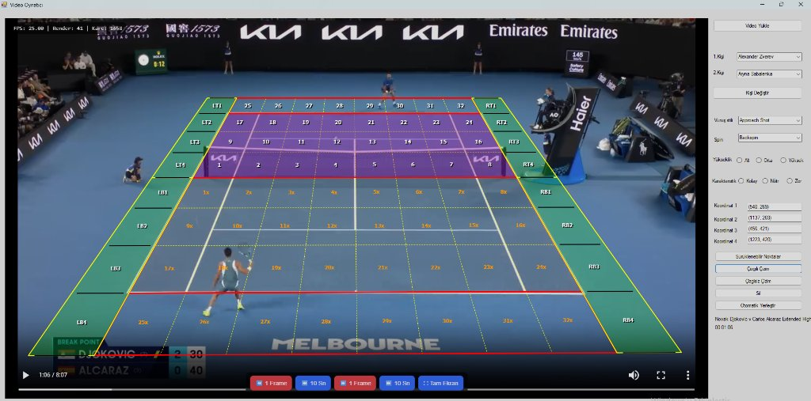
</p>

### 2. Sadeleştirilmiş Ana Sayfa
Kullanıcının doğrudan tenis modüllerine odaklanmasını sağlayan modern ve temiz ana kontrol paneli:

<p align="center">
  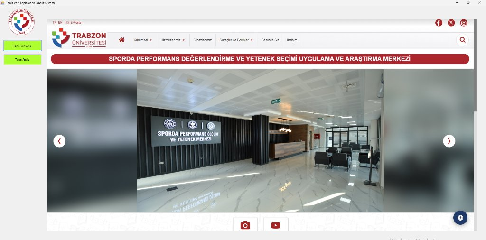
</p>

### 3. Tenis Veri Girişi ve Kategori Yönetimi
Sporcular, vuruş stilleri, spin çeşitleri ve maç veritabanı yönetim modülü:

<p align="center">
  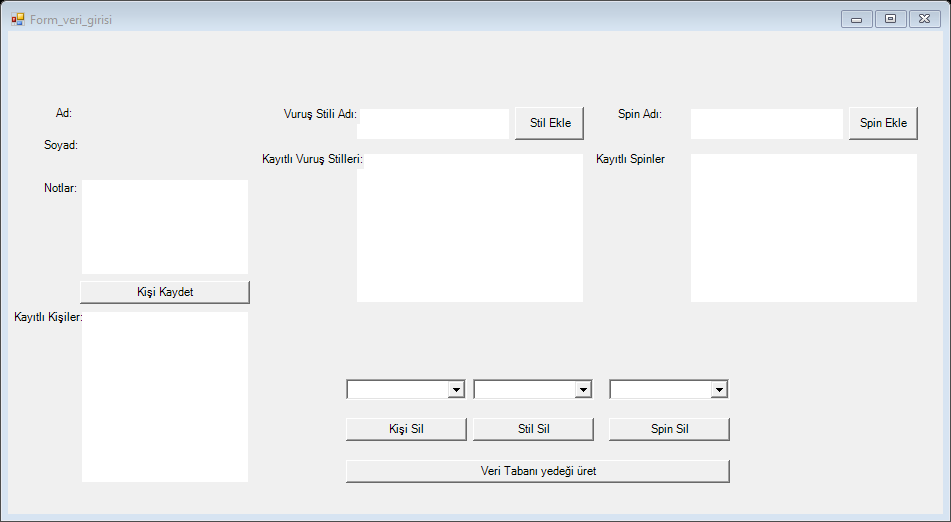
</p>

---

## 📹 Hazır Örnek Test Videosu
Projeyi hemen test edebilmeniz için depoya örnek bir tenis maçı video kaydı dahil edilmiştir:
* **Örnek Video:** `Novak Djokovic v Carlos Alcaraz Extended Highlights _ Australian Open 2025 Quarterfinal.mp4`
* Video analiz modülünü açıp bu videoyu doğrudan seçerek kort kalibrasyonunu ve veri etiketleme adımlarını anında test edebilirsiniz.

---

## 🧠 Özgün Python Algoritmaları ve Akıllı Kort Köşe Tespiti

Sistemin en kritik ve özgün bileşeni; tenis kortunun köşe sınırlarını insan müdahalesine gerek kalmadan veya asgari kalibrasyonla milimetrik olarak çıkaran **Python bilgisayarlı görü (Computer Vision) analiz motorudur** (`court_detect.py`, `overlay_rect.py`, `test_corners.py`).

<p align="center">
  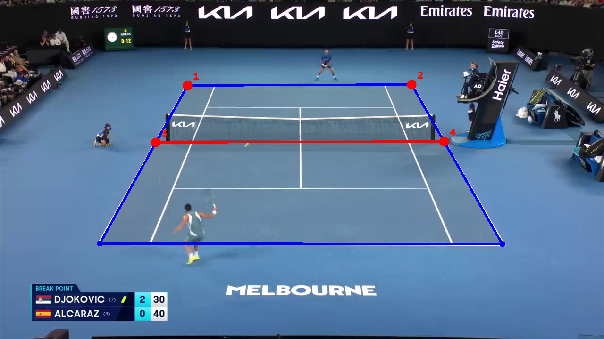
  <br />
  <em>Şekil 1: Novak Djokovic - Carlos Alcaraz Avustralya Açık maçında <code>court_detect.py</code> algoritmasının ürettiği 4 köşe poligonu (mavi), homografi tabanlı file/orta çizgi tespiti (kırmızı) ve referans noktaları (TL, TR, ML, MR).</em>
</p>

### 1. Kort Köşe Veri Tabanı (`corners/` Klasörü)
Kort köşe tespit motoru, farklı zemin türleri (Melbourne mavi sert kort, Roland Garros kırmızı toprak kort, Wimbledon çim kort), farklı kamera açıları, gölge ve aydınlatma koşullarında çekilmiş **100'ü aşkın gerçek kort köşe şablonundan** (`corners/corner_001_img01.jpg` .. `corner_101_img27.jpg`) oluşan zengin bir şablon kütüphanesine sahiptir.

#### Örnek Köşe Şablonları (Template Patches):
<p align="center">
  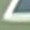
  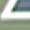
  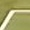
  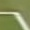
  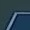
  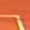
  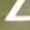
  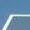
  <br />
  <em>Şekil 2: Farklı kamera açılarından, zemin dokularından ve ışıklandırmalardan kırpılmış 30×30 piksellik referans köşe şablonları.</em>
</p>

---

### 2. Aydınlatma ve Zemin Renginden Bağımsız Canny Kenar Tabanlı Şablon Eşleme
Geleneksel RGB piksel renk karşılaştırması farklı turnuva kortlarında (mavi, yeşil, kırmızı kiremit) veya ışık/gölge değişimlerinde yanılgıya düşer. Bu sorunu çözmek için geliştirilen pipeline:

1. **Kenar Çıkarımı (Edge-based Processing):** Hem maç video karesi hem de tüm 101 köşe şablonu önce $3 \times 3$ Gaussian filtresiyle pürüzsüzleştirilir, ardından Canny kenar filtresinden (`CANNY_LOW = 50`, `CANNY_HIGH = 150`) geçirilir. Bu sayede zemin rengi tamamen elenerek yalnızca kort çizgilerinin beyaz kesişim geometrisi elde edilir.
2. **Normalleştirilmiş Çapraz Korelasyon (NCC):** Her bir köşe kenar şablonu, görüntü üzerinde `cv2.matchTemplate(..., cv2.TM_CCOEFF_NORMED)` fonksiyonuyla taranır.

<p align="center">
  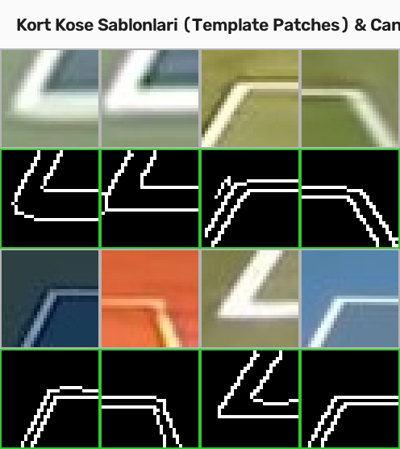
  <br />
  <em>Şekil 3: Orijinal köşe şablonları (üst) ve parlaklık/renk bağımsızlığını sağlayan Canny kenar dönüşümleri (alt).</em>
</p>

---

### 3. Mekânsal Yoğunluk Kümeleme (Spatial Density Clustering)
Aynı köşe noktası için onlarca komşu pikselde yüksek korelasyon skoru üretilir. `cluster_candidates` fonksiyonu:
* Aday eşleşmeleri koordinat mesafelerine göre gruplar (`CLUSTER_DIST_RATIO` = görüntü genişliğinin %2'si).
* Küme içerisindeki adayların skor ağırlıklı ortalama merkezini $\bar{x} = \frac{\sum w_i x_i}{\sum w_i}, \bar{y} = \frac{\sum w_i y_i}{\sum w_i}$ hesaplayarak tekil, net ve yüksek doğruluklu köşe adaylarına (`TOP_K = 20`) dönüştürür.

---

### 4. Katı Geometrik Kısıtlar ve Simetri Doğrulama (`check_geometric_rules`)
Rastgele kenar kesişimlerinin (örneğin reklam panoları, tribün korkulukları) elenmesi için gerçek tenis kortu perspektif kuralları matematiksel olarak denetlenir:

| Geometrik Kural | Matematiksel Tanım | Amaç |
| :--- | :--- | :--- |
| **Minimum Piksel Mesafesi** | $\text{dist}(P_i, P_j) \ge 250\text{ px}$ | Birbirine çok yakın sahte noktaları engeller. |
| **Perspektif Genişlik Oranı** | $W_{\text{top}} \le 1.1 \cdot W_{\text{bottom}}$ | Kamera perspektifi gereği üst dip çizgi alt çizgiden daima dardır. |
| **Yatay Y-Hizalama Toleransı** | $\|y_{\text{sol}} - y_{\text{sağ}}\| \le 0.08 \cdot H_{\text{img}}$ | Üst ve alt köşe çiftlerinin yatayda düz bir hat oluşturmasını sağlar. |
| **Yan Çizgi Eğim Simetrisi** | $m_L < 0,\ m_R > 0$ ve $\frac{\|\|m_L\| - \|m_R\|\|}{\max(\|m_L\|, \|m_R\|)} \le 0.20$ | Sol yan çizgi sola, sağ yan çizgi sağa eğimlidir ve mutlak eğimler %20 simetri toleransı içindedir. |

---

### 5. Çift Kademeli Çözüm ve Eksik Köşe Kestirimi (Missing Corner Estimation)
Maç esnasında oyuncular, file direkleri, hakem kulesi veya kamera açısının dışına taşma nedeniyle kortun bir köşesi geçici olarak kapanabilir:

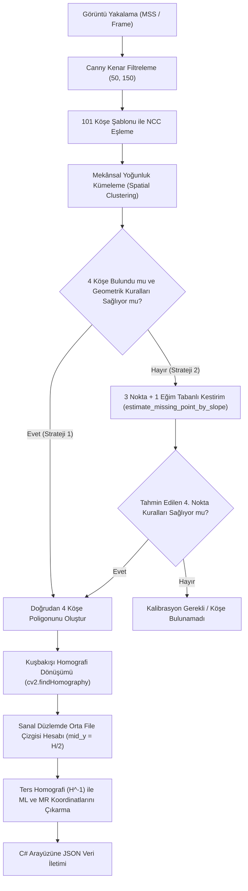

> [!IMPORTANT]
> **Strateji 2 - 3 Nokta + 1 Tahmin Modeli (`estimate_missing_point_by_slope`):**  
> Eğer köşelerden biri oyuncu veya hakem koltuğu tarafından engellenmişse, kalan 3 köşe tespit edilir. Sağlam olan karşı yan çizginin eğimi $m_{\text{ref}}$ alınarak, simetri ilkesi gereği $m_{\text{kayıp}} = -m_{\text{ref}}$ kabul edilir. Kayıp köşenin koordinatları perspektif doğrultusu ve karşı köşe referansı kullanılarak matematiksel olarak yeniden türetilir.

---

### 6. Kuşbakışı Homografi Dönüşümü ve File / Servis Çizgisi Tespiti
Kortun dört köşesi ($TL, TR, BR, BL$) bulunduktan sonra:
1. `cv2.findHomography` ile kamera açısındaki yamuk kort poligonu sanal dikdörtgen $W \times H$ kort düzlemine açılır (Bird's Eye View).
2. Kortun tam matematiksel ortası $mid_y = \frac{H - 1}{2}$ olarak hesaplanır.
3. Ters homografi matrisi $H^{-1}$ ve `cv2.perspectiveTransform` kullanılarak orta file çizgisinin video karesindeki sol ve sağ başlangıç noktaları ($ML, MR$) kesin piksel doğruluğuyla elde edilir.
4. Çıktı C# WinForms arayüzüne standart JSON formatında aktarılır:
   ```json
   {
     "tl": [397.5, 181.5],
     "tr": [872.9, 179.1],
     "ml": [330.8, 302.0],
     "mr": [941.3, 300.3],
     "temp_image": "temp/20261108_010313.jpg",
     "debug_image": "temp/20261108_010313_debug.jpg"
   }
   ```

---

### 7. Python Destekli Yardımcı Çekirdek Modüller

#### `overlay_rect.py` — Donanım Hızlandırmalı Şeffaf Izgara Katmanı
* **PyQt5 & OpenGL Tabanlı Şeffaf Arayüz:** Masaüstünde video oynatıcının üzerine binen tamamen şeffaf (`WA_TranslucentBackground`), daima üstte (`WindowStaysOnTopHint`) çalışan vektörel çizim motoru.
* **32 Bölge ve Yan Koridor Haritalandırması:** Kortu 1..32 mor servis/orta oyun kutuları, 1x..32x turuncu arka kort bölgeleri ve LT1..LT4, RT1..RT4, LB1..LB4, RB1..RB4 yan koridor dilimlerine ayırır.
* **Global Klavye Dinleyicisi (`keyboard`):** Kullanıcı video üzerinde topun düştüğü yere fareyle gelip **`X`** tuşuna bastığında koordinatın hangi kort hücresine denk geldiği anında algılanarak C# formundaki veri alanlarına yazılır. **`H`** tuşu ile çizim anında gizlenip açılabilir.

#### `test_corners.py` — İnteraktif Sürüklenebilir Köşe Kalibrasyon Aracı
* Form üzerindeki *"Sürüklenebilir Noktalar"* butonuna tıklandığında ekranın 4 köşesinde beliren interaktif kırmızı kontrol noktaları.
* Noktalar kullanıcı tarafından fareyle sürüklendiğinde, arka plandaki hafif **TCP Soket Sunucusu (`SocketClient`)** üzerinden yeni $(X, Y)$ koordinatlarını anlık olarak C# arayüzündeki metin kutularına iletir.

---

## 🎯 Temel Yetenekler Özeti

### 1. Tenis Video Analizi ve Kort Eşleme Modülü
* **Gelişmiş Kare Kare Video İnceleme:** Yüksek çözünürlüklü maç kayıtlarını saniye veya kare (frame) hassasiyetiyle durdurup vuruş anını analiz edebilme.
* **Otomatik Kort Tespiti (`court_detect.py`):** Bilgisayarlı görü ve şablon eşleme algoritmalarıyla kortun 4 köşe noktasını tek tıkla otomatik bulma.
* **Sürüklenebilir Referans Noktaları (`test_corners.py`):** Ekran üzerinde beliren 4 adet interaktif kırmızı referans noktasıyla kort sınırlarını milimetrik olarak elle ayarlayabilme (TCP soket ile arayüzle eş zamanlı çift yönlü veri akışı).
* **Homografi Matrisi ile Izgara Çizimi (`overlay_rect.py`):**
  * Perspektif düzeltme (Homography transform) uygulanmış 8×3 ana ızgara bölgesi.
  * Üst servis alanı (25..32) ve alt dip kort bantları (1x..32x).
  * Yan koridor ve şerit bölgeleri (LT1..LT4, RT1..RT4, LB1..LB4, RB1..RB4).
* **Tek Tuşla Hızlı Veri Etiketleme ('X' Kısayolu):**
  * Maç sırasında topun yere çarptığı veya oyuncunun vuruş yaptığı noktaya fare imlecini getirip klavyeden **`X`** tuşuna basıldığında ilgili kort bölge numarası otomatik tespit edilir.
  * *Vurulan Bölge*, *Düştüğü Bölge*, *Nereden Geldi* ve *Buluşulan Bölge* alanları form üzerinde sıralı olarak otomatik doldurulur.
* **Katman Temizleme:** Ekrandaki tüm çizgileri ve süreçleri dilediğiniz anda tek tuşla sıfırlama.

### 2. Tenis Veri Girişi ve Veritabanı Modülü
* **Sporcu Yönetimi:** Oyuncu profilleri, ad, soyad ve antrenör notlarının kaydı.
* **Vuruş ve Spin Kategorizasyonu:** Forehand, backhand, vole gibi vuruş stilleri ile topspin, slice ve flat gibi spin türlerinin dinamik yönetimi.
* **Yapılandırılmış SQLite Depolama:** Tüm toplanan etiketleme verilerinin yerel veritabanında saklanması ve istendiğinde tek tuşla yedeklenmesi.

### 3. Arka Plan Modülleri (Genişletilebilir Altyapı)
Ana ekranda tenis süreçlerine odaklanılmış sade bir görünüm sunulmakla birlikte; proje kod tabanında kaleci analizi, GPS, oryantiring, UTMB ve kinematik analiz gibi çok disiplinli spor teknolojisi altyapısı mevcuttur.

---

## ⚙️ Gereksinimler ve Kurulum

### Sistem Gereksinimleri
* **İşletim Sistemi:** Windows 10 veya Windows 11 (64-bit)
* **Geliştirme Ortamı:** Visual Studio 2019 / 2022 veya MSBuild
* **Framework:** .NET Framework 4.7.2 / 4.8
* **Python Sürümü:** Python 3.10 veya üzeri (PATH'e eklenmiş olmalıdır)

### Python Kütüphanelerinin Kurulumu
Analiz, köşe tespiti ve çizim motoru için gerekli paketleri yükleyin:

```bash
pip install PyQt5 keyboard opencv-contrib-python numpy mss scikit-image
```

### Projeyi Çalıştırma
1. Depoyu klonlayın:
   ```bash
   git clone https://github.com/purkusur-pixel/spor-yazilimlari.git
   ```
2. `SporcuTakip.sln` çözüm dosyasını Visual Studio ile açın.
3. Çözümü derleyin ve çalıştırın (`F5` veya `Ctrl+Shift+B`).
4. **Tenis Analiz** butonuna basarak örnek videoyu seçin, **Otomatik Yerleştir** butonuyla Python köşe tespit algoritmasını çalıştırın veya **Sürüklenebilir Noktalar** ile kort kalibrasyonunu tamamlayın.

---

## 🏛 Proje Desteği ve Atıf

<p align="center">
  
  &nbsp;&nbsp;&nbsp;&nbsp;&nbsp;&nbsp;
  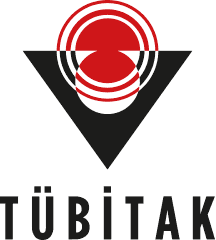
</p>

<p align="center">
  <b>Trabzon Üniversitesi Spor Bilimleri Fakültesi</b><br />
  <b>Trabzon Üniversitesi Sporda Performans Değerlendirme ve Yetenek Seçimi Uygulama ve Araştırma Merkezi</b>
</p>

Bu çalışma, Türkiye Bilimsel ve Teknolojik Araştırma Kurumu (TÜBİTAK) tarafından 1001 Programı – Spor Araştırmaları kapsamında desteklenen 124M890 numaralı "Tenis için Yapay Zekâ Destekli Top Atma Makinesi Üretimi" başlıklı proje kapsamında gerçekleştirilmiştir.

This study was supported by the Scientific and Technological Research Council of Türkiye (TÜBİTAK) under the 1001 Programme – Sports Research (Project No: 124M890) within the scope of the project titled "Production of an Artificial Intelligence-Assisted Ball-Throwing Machine for Tennis".

**Proje Yürütücüsü:** Prof. Dr. Serdar Alemdağ  
**Yazılım Geliştirici:** Hüsnü Canbolat (husnucanbolat@trabzon.edu.tr)  
**Çalışma Kapsamı:** Profesyonel tenis maç videolarında Canny kenar tabanlı şablon eşleme ile kort köşelerini otomatik tespit eden, homografi dönüşümüyle 32 bölgeli kort ızgarası oluşturan ve vuruş/düşme bölgelerini tek tuşla etiketleyerek SQLite veritabanına kaydeden C#/Python hibrit tenis veri toplama ve video analiz aracı geliştirilmiştir.  
**Lisans:** MIT License — ayrıntılar için [LICENSE](LICENSE) dosyasına bakınız.

Bu çalışmayı akademik veya endüstriyel projelerinizde kullanırsanız lütfen depoya atıfta bulununuz.
